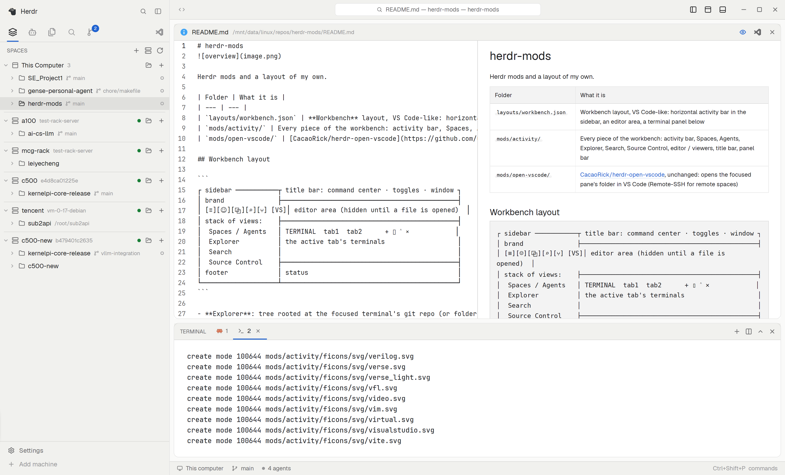

# Workbench

A VS Code-like workbench for Herdr: a sidebar of Spaces, Agents, Explorer,
Search and Source Control, an editor area, and the active tab's terminals
below. It follows the current Herdr theme.



This file is the brief: enough to build Workbench from an empty folder. The
files next to it are one build of it. If they don't work on your Herdr, or you
want it different, build it again from here.

## What you see

1. **The sidebar**, 300px, `chrome` colored. A 46px brand row, a horizontal
   40px activity bar (Spaces, Agents, Explorer, Search, Source Control,
   VS Code), then one stacked view, and a 69px footer.
2. **The title bar**, 40px with no system decoration: the command center
   (active space, tab and folder), layout toggles, and an `SSH: <machine>`
   chip for remote spaces.
3. **The work area**, padded 8px with 8px gaps. The editor area starts
   hidden and takes 3 parts of the height when shown; the terminal panel
   takes 2. The panel has a 34px header with tabs, then the active tab's
   terminals, 6px gaps and 6px rounded panes.
4. **The status bar**, 28px: machine, branch, agent count on the left;
   commands on the right.

Both the editor area and the terminal panel are rounded, bordered cards.
The Explorer, Search, Source Control, editor and viewers use Material file
icons.

## How it behaves

- **Spaces**: spaces grouped by machine (this computer, then `hc machine ls`),
  each with branch, agent status and tabs. Open Folder…, New Space and
  recent folders; right-click a space or tab for Herdr's menu.
- **Agents**: live agents with title, model, status and location; History
  lists resumable sessions (Claude Code, Codex, pi, omp, opencode) for the
  open workspace. Click resumes, Shift+click forks where supported.
- **Explorer**: the focused terminal's git repo or folder, with git marks.
  Right-click for file operations, Cut / Copy / Paste, Rename, Delete and
  Open in VS Code. Desktop files can be dropped in, including onto a remote
  machine. Remote deletes are asked first and permanent.
- **Search**: ripgrep, then `git grep`, then `grep`; case, whole word, regex.
- **Source Control**: stage / unstage / discard, commit, pull (ff-only),
  push, recent commits, per-file diffs.
- **Editor**: syntax-highlighted text, diffs, Markdown split preview, and
  image / PDF / media / binary viewers with zoom. Remote saves refuse if the
  file changed since it was opened.
- **Keys**: Ctrl+Alt+1…5 for the sidebar views, Ctrl+` for the terminal
  panel, Ctrl+Alt+E for the editor, Ctrl+S / Ctrl+W in the editor,
  Ctrl+Shift+V for Markdown preview. See `keys.json`.
- The editor area remembers one open file per space, and hides itself when
  toggled off. In other layouts the same mod opens the editor as a pane.

## Built from

- **The layout** (`layouts/workbench.json`): a root `row` with
  `titlebar: "none"`, semantic colors (`canvas`, `chrome`, `border`,
  `accent`), `traffic_lights` and 14/12 terminal padding. The sidebar is a
  `column` with fixed brand, activity bar, a `stack` of five views and a
  footer. The right side is a `column`: title bar, a padded body (hidden
  editor `weight: 3`, terminal panel `weight: 2`) and the status bar.
  Terminal panes use `tab: "active"`, `lone: false`, hover headers.
- **One mod** (`mods/activity/`), selected by `props.view`: `bar`, `spaces`,
  `agents`, `files`, `search`, `git`, `editor`, `titlebar`, `panelbar`,
  `menu`, `fileprompt`. `main.js` dispatches to a class with `init`,
  `render` and optional `release`.
- **Optional mod** (`mods/open-vscode/`): third-party, unchanged; Ctrl+Shift+G
  opens the focused folder in VS Code, Remote-SSH for remote spaces.
- **Shipped parts**: `workspace-chrome` for the brand and footer,
  `workspace-status`, `pane` headers, and Herdr's `menu` mod for
  right-click menus.
- **Data and I/O:** `spaces()`, `agents()`, `panes()`; `sh` / `hc exec` for
  local and remote shell work; one round trip per Explorer (4s) and Source
  Control (5s) refresh over SSH; long transfers run as detached jobs.
  `EditorState` / `Editor` handles text; poppler, ffmpeg and ffprobe power
  the PDF and media viewers. Session history is scanned by an embedded
  python3 script on the space's machine.

## Watch out

- The editor cannot jump to a line yet; text files over 1 MB open in the
  viewer. Moving files inside the tree is Cut / Paste only. Video does not
  play inside Herdr.
- Remote features need `hc` and SSH access; agent history needs `python3`
  there. PDF needs `pdftoppm`, other images and media need `ffmpeg` /
  `ffprobe`, file clipboard needs `wl-clipboard` or `xclip`, and the Trash
  needs `gio`. Missing tools degrade with a message.
- Remote deletes are `rm -rf`, not the Trash, so they are confirmed first.
- The mod is local-first: `watchFolder`, `writeTextFile` and image paths are
  local. Remote work polls and caches under `mods/activity/.cache/`.
- If `workbench` or `activity` is taken, rename the layout and mod references
  consistently; `mods/activity` also owns the `.cache` and file icons.

## Done when

- The sidebar switches between all five views with Ctrl+Alt+1…5 or clicks.
- The Explorer lists the focused space's files, and git marks follow edits.
- A file opens in the editor; Ctrl+S saves locally and remotely; toggling the
  editor and terminal panel changes the split.
- Live agents and History show the open workspace's sessions, and clicking
  one resumes it.
- `herdr-app check mods/activity` passes, and switching spaces and layouts
  back and forth works.

## Install

```sh
./install.sh
# merge keys.json into ~/.config/herdr-app/keys.json once
herdr-app do layout.switch --name workbench
```
